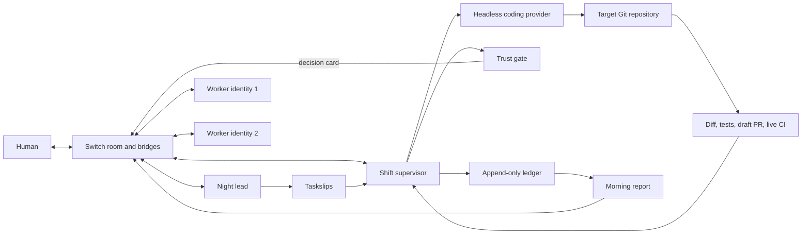

# Night Shift architecture

Night Shift is an overnight software-delivery control loop built around Switch.
The system separates code generation from trust decisions: coding providers can
prepare a change, while the supervisor independently verifies the result and a
human authorizes the exact commit that may merge.

## System overview



## Components

### Switch and collaboration bridges

Switch is the shared communication layer. It owns room identity, agent identity,
addressing, ordered events, reconnect cursors, and bridges to Mattermost, Slack,
Discord, Teams, and Telegram. Night Shift consumes Switch's agent protocol and
does not parse vendor webhook payloads directly.

The local Docker stack exposes:

- Switch Core on port `8000`
- Mattermost on port `8065`
- Switch Gateway on port `3100`

### Crew template

`crew/nightshift.template.yaml` defines the room and three crew identities:

- **night lead** — turns the human goal into bounded taskslips;
- **worker 1** and **worker 2** — acknowledge assignments and negotiate file
  claims in the shared room;
- **shift supervisor** — a separately provisioned protocol agent that executes
  the night and enforces trust gates.

`crew/taskslip.schema.md` and `crew/receipt.schema.md` define the contracts shared
by every provider.

### Shift supervisor

The TypeScript supervisor in `supervisor/src/` is the execution and control
plane. Its main responsibilities are:

1. connect to Switch and resume from a persisted event cursor;
2. accept a human `tonight:` goal;
3. load and validate taskslips;
4. start bounded coding-provider processes on isolated branches;
5. collect the actual diff, test exit code, raw log tail, and elapsed time;
6. create draft pull requests with normalized receipts;
7. inspect live CI, repository policy, reviewer findings, and the current head
   SHA;
8. honor human approve, hold, inspect, and rollback commands;
9. append machine-readable events and produce the morning report.

The supervisor has no runtime npm dependencies beyond Node.js APIs. TypeScript
is used for compilation and tests.

### Headless coding providers

The spawner supports OpenCode, Codex, and Claude through a common contract. A
worker receives one taskslip, runs within the target repository, and is stopped
when its budget expires. Provider output is advisory; the supervisor replaces
claims about files, tests, and time with facts collected from the real run.

### Target repository

`target/` is a separately versioned demo service initialized by
`scripts/bootstrap.sh`. Each task runs on a `shift/<task-id>` branch. The target
is excluded from the outer repository because it has its own Git history.

### Trust gate

The trust gate combines independent evidence:

- receipt completeness;
- actual files touched versus the taskslip allowlist;
- real test result and raw output;
- live GitHub CI status;
- repository path and change-budget policy;
- independent reviewer findings;
- the exact PR head SHA.

An approval is bound to the evidence fingerprint and head commit. If the branch
changes, the previous approval expires. `gh pr merge --match-head-commit` keeps
the final GitHub operation bound to the reviewed SHA.

### Collision negotiation

Before overlapping work lands, the supervisor compares file claims and changed
paths. Workers state their claim in the Switch room and agree on an order. The
later branch rebases after the earlier change, reruns tests, and receives fresh
evidence before it can be approved.

### Ledger and reports

`supervisor/src/ledger.ts` is the append-only event boundary. Goals, task starts,
PRs, refusals, approvals, rollbacks, blocks, collisions, and report publication
are stored as JSON Lines. The ledger is runtime state and is not committed.

`supervisor/src/report.ts` folds the current ledger window into a deterministic
morning report with merges, holds, rollbacks, blocks, worker statistics, and a
recommendation. Scheduled and manual report triggers use the same publisher.

## Data flow

1. A human posts `tonight: <goal>` in a connected room.
2. The night lead writes scoped taskslips with acceptance criteria, allowed
   files, assignee, and time budget.
3. The supervisor validates the slips and launches one bounded worker per task.
4. The worker changes code and runs tests on an isolated branch.
5. The supervisor measures the run, normalizes the receipt, and opens a draft PR.
6. The supervisor posts a decision card containing current evidence.
7. The human inspects, approves, holds, or rolls back the task in the room.
8. The supervisor records the outcome and continues with the remaining work.
9. The ledger is folded into the morning report and posted through Switch.

## Trust invariants

- No worker may merge its own change.
- Receipt claims never override the actual diff or test process.
- A failing or missing test result cannot be approved.
- CI is read at decision time, not copied from an earlier message.
- Blocked paths cannot be waived by a green test suite.
- Approval applies to one exact head SHA and expires after a push or rebase.
- Every refusal and human decision is written to the ledger.
- Collaboration platforms reach the supervisor only through Switch.

## Repository layout

```text
crew/             room template, taskslip schema, receipt schema, policy
demo/             deterministic isolated demo
docs/             operator guides
landing/          dependency-free website and HTML docs
ops/              Docker Compose and environment examples
scripts/          bootstrap, Slack connection, and verification commands
supervisor/src/   execution, protocol, evidence, gates, and reporting
supervisor/test/  unit and integration tests
target/           separately versioned demo application (git-ignored)
```

## Failure behavior

- Invalid taskslip: reject the file and name the field and line.
- Worker timeout: terminate the process group, record the block, continue.
- Missing receipt field: keep the PR draft and post `needs-eyes`.
- Red or pending CI: refuse approval without closing the PR.
- Changed head SHA: expire approval and require a fresh inspection.
- Switch disconnect: reconnect from the persisted cursor.
- Duplicate connection identity: stop on takeover instead of competing.
- Report post failure: do not mark the report as published.

## Verification

```sh
npm run build --prefix supervisor
npm test --prefix supervisor
node demo/run.mjs demo/night.yml --offline
./scripts/verify.sh --offline
```

The supervisor test suite covers protocol handling, task parsing, worker
budgets, receipts, gates, collision ordering, reports, and reconnect behavior.
