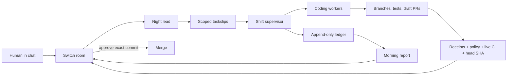

# Night Shift

Night Shift is a Switch-native engineering crew that turns unattended AI coding
into a reviewable team process. A human sets an overnight goal in chat; the crew
creates scoped tasks, runs coding agents on isolated branches, validates their
receipts against the actual diff and test output, and returns decision-ready pull
requests with a concise morning report.

The core rule is simple: **agents can prepare work, but only a human can approve
the exact commit that merges.**

## What it does

- Converts one goal into bounded taskslips with file and time limits.
- Runs OpenCode, Codex, or Claude as non-interactive workers.
- Records actual files changed, test results, raw log tails, and elapsed time.
- Detects overlapping file claims before parallel work collides.
- Checks repository policy, live GitHub CI, reviewer findings, and the PR head SHA.
- Expires approval when a new push changes the reviewed commit.
- Posts approvals, holds, rollbacks, and the 9 AM report through Switch.
- Supports Mattermost, Slack, Discord, Teams, and Telegram through Switch bridges.

## How it works



Switch owns the shared room, identities, addressing, ordered event history, and
collaboration bridges. The supervisor owns task execution, receipts, policy
checks, GitHub state, human gates, and reporting.

## Requirements

- Docker with Compose
- Git
- Node.js 22+
- npm, OpenSSL, and curl
- GitHub CLI (`gh`) authenticated to your account
- An authenticated OpenCode, Codex, or Claude CLI

## Quickstart

```sh
git clone https://github.com/shashwat558/night-shift.git
cd night-shift
./scripts/bootstrap.sh

docker compose -f ops/standalone-docker-compose.yml \
  --profile collab --profile gateway up -d --wait

node supervisor/dev-tools/provision-crew.mjs
npm run build --prefix supervisor
node supervisor/dist/src/provision.js
node supervisor/dist/src/main.js
```

Local services:

- Switch Core: <http://localhost:8000>
- Mattermost: <http://localhost:8065>
- Switch Gateway: <http://localhost:3100>

`bootstrap.sh` installs dependencies, builds the supervisor, initializes the
separately versioned demo target, and creates local environment secrets only
when they do not already exist.

## Choose a coding worker

Set `WORKER_PROVIDER` in `supervisor/.env`:

```dotenv
WORKER_PROVIDER=opencode
# WORKER_PROVIDER=codex
# WORKER_PROVIDER=claude
```

Every provider receives the same taskslip and must pass through the same test,
receipt, policy, CI, and human-approval pipeline.

## Run a shift

Post a goal in the connected team room:

```text
tonight: fix pagination and add regression coverage
```

Use typed gate commands for the resulting tasks:

```text
@shift-supervisor inspect <task-id>
@shift-supervisor approve <task-id>
@shift-supervisor hold <task-id>
@shift-supervisor rollback <task-id> <reason>
@shift-supervisor shift report please
```

Approval succeeds only when the receipt is complete, tests pass, CI is green at
read time, repository policy passes, and the reviewed head SHA still matches.

## Repository policy

Teams own the overnight boundaries in
[`crew/nightshift.policy.yml`](crew/nightshift.policy.yml):

```yaml
max_changed_files: 8
max_budget_minutes: 30
reviewer_required: true
blocked_paths:
  - migrations/**
  - .github/workflows/**
review_paths:
  - src/auth/**
  - src/payments/**
```

Blocked paths remain blocked even when tests are green. Review paths require
explicit attention. A new push invalidates the previous evidence fingerprint.

## Messaging apps

Night Shift talks only to Switch; it does not operate separate vendor bots.
For Slack, generate the version-matched manifest and connect the bridge:

```sh
node scripts/connect-slack.mjs manifest
cp ops/slack.env.example ops/slack.env
chmod 600 ops/slack.env
# Add the local xoxb- and xapp- credentials, then:
node scripts/connect-slack.mjs connect
```

See the [messaging guide](docs/messaging-apps.md) for Slack channel adoption and
the Discord, Telegram, and Teams boundaries.

## Demo and verification

Run the deterministic demo without external AI or GitHub calls:

```sh
node demo/run.mjs demo/night.yml --offline
```

Run the repository checks:

```sh
npm run build --prefix supervisor
npm test --prefix supervisor
./scripts/verify.sh --offline
```

The demo uses an isolated temporary Git remote and does not modify the target
checkout or the production ledger.

## Landing page

The dependency-free website lives in [`landing/`](landing/):

```sh
python3 -m http.server 4173
```

Open <http://127.0.0.1:4173/landing/>. Its documentation links open static HTML
pages rather than raw Markdown files.

## Documentation

- [Architecture](ARCHITECTURE.md)
- [Trust-gate manual](docs/gates-manual.md)
- [Messaging-app setup](docs/messaging-apps.md)
- [Live demo runbook](docs/live-demo-runbook.md)

## Limitations

- Provider-backed workers require your own authenticated CLI account.
- Switch and collaboration-platform credentials remain local and are never
  committed.
- The bundled demo target is intentionally small; production repositories need
  policy rules appropriate to their own sensitive paths and CI requirements.
