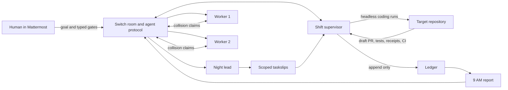

# Night Shift

AI coding agents can produce a pile of overnight pull requests faster than a
human can establish which ones are safe. Night Shift turns that unattended
work into a visible team process: scoped taskslips, raw test receipts, current
CI checks, explicit human gates, collision negotiation, and a 9 AM report.

Night Shift is a Switch-native overnight engineering crew. A human sets the
goal in Mattermost; Switch carries every room event to the crew and supervisor;
the supervisor opens draft work, refuses unsafe merges, and records an
append-only ledger that can be replayed without trusting chat summaries.

Its trust-control layer makes the morning handoff concrete: repository policy
checks the actual PR diff, an independent reviewer challenges receipt claims,
and Switch posts a decision card bound to the PR's exact commit. A later push
changes the evidence fingerprint and expires the earlier decision.

## Landing page

The project landing page lives in [`landing/`](landing/) and has no build-time
dependencies. Preview it locally with:

```sh
python3 -m http.server 4173
```

Then open `http://127.0.0.1:4173/landing/`.

## Architecture



## Quickstart

Requirements: Docker with Compose, Git, Node 22+, npm, OpenSSL, curl, GitHub CLI,
and an authenticated coding-agent CLI (OpenCode or Codex; OpenCode is the
default). The deterministic demo itself makes no AI or GitHub API calls.

```sh
git clone https://github.com/shashwat558/night-shift.git
cd night-shift
./scripts/bootstrap.sh

docker compose -f ops/standalone-docker-compose.yml \
  --profile collab --profile gateway up -d --wait

until curl -fsS http://127.0.0.1:8000/health >/dev/null; do sleep 2; done

node supervisor/dev-tools/provision-crew.mjs
npm run build --prefix supervisor
node supervisor/dist/src/provision.js

node demo/run.mjs demo/night.yml --live
./scripts/verify.sh --offline
```

`bootstrap.sh` clones the separately versioned petshop target, installs locked
dependencies, builds the supervisor, and generates `ops/.env` with random
local secrets when it is absent. It never replaces an existing environment.
The Gateway is at `http://localhost:3100`, Mattermost at
`http://localhost:8065`, and Switch Core at `http://localhost:8000`.

Select the coding worker in `supervisor/.env`:

```dotenv
# Keep the existing OpenCode worker:
WORKER_PROVIDER=opencode

# Or use the Codex CLI authenticated on this machine:
# WORKER_PROVIDER=codex
```

OpenCode runs as `opencode run`. Codex runs as a bounded, non-interactive
`codex exec` session with an ephemeral history and the `workspace-write`
sandbox. Both feed the same taskslip, test, receipt, PR, budget, and human-gate
pipeline; changing providers does not bypass Night Shift's trust controls.

## Slack, Discord, Teams, and Telegram

The same Dockerized Switch Core already includes all collaboration adapters;
Night Shift does not run a separate bot or bypass Switch. For Slack, generate
the version-matched manifest and connect the credentials with:

```sh
node scripts/connect-slack.mjs manifest
cp ops/slack.env.example ops/slack.env
chmod 600 ops/slack.env
# Fill the xoxb- and xapp- values, then:
node scripts/connect-slack.mjs connect
```

The supervisor accepts a comma-separated `SWITCH_ROOM_IDS` list and returns
each command, decision card, and outcome to its originating room. See the
[messaging-app guide](docs/messaging-apps.md) for channel adoption and the
Discord, Telegram, and Teams boundaries.

For a terminal-only rehearsal that still creates real local branches, runs the
real target tests, validates receipts, exercises the gate table, forces and
resolves the configured Git collision, and replays its ledger:

```sh
node demo/run.mjs demo/night.yml --offline
```

The scripted demo uses an isolated temporary Git remote and labels every room
post `[scripted demo]`; it never mutates the target checkout or production
ledger. Its three slips yield two local merges, one rollback, and one genuine
add/add collision resolved in the workers' agreed order, normally in seconds.

## Receipts and trust gates

Every candidate ends with the same machine-checked receipts block: summary,
actual files touched, PASS/FAIL, raw test-log tail, risk call, deviations, and
measured budget. Missing fields become `needs-eyes`. A receipt saying FAIL can
never merge, and `approve` is honored only when CI is green at read time.

The room commands are deliberately typed because Switch 0.31.0 does not expose
human reaction events to agents:

```text
@shift-supervisor approve <task-id>
@shift-supervisor rollback <task-id> <reason>
@shift-supervisor hold <task-id>
@shift-supervisor inspect <task-id>
@shift-supervisor shift report please
```

## Repository trust policy

Teams own the rules in [`crew/nightshift.policy.yml`](crew/nightshift.policy.yml):

```yaml
max_changed_files: 8
max_budget_minutes: 30
reviewer_required: true
blocked_paths:
  - migrations/**
  - .github/workflows/**
review_paths:
  - src/auth/**
  - src/payments/**
```

`inspect` reads the live GitHub PR body, file list, CI rollup, and head SHA.
The trust reviewer compares those facts with the receipt and policy, then
posts a Switch decision card with its evidence fingerprint. Approval passes
the reviewed SHA to GitHub's `--match-head-commit`; a changed branch is refused
instead of merging under stale evidence. Blocked paths remain blocked even
when their tests are green.

## What Switch does here

Switch is the shared world, not a notification wrapper. It owns the bridged
Mattermost room, agent identities, addressing, ordered room log, WebSocket
event delivery, reconnect cursors, and HTTP operations used for every crew
message. Goals, assignments, worker claims, human gates, rollback reasons, and
the morning report all cross the Switch agent protocol. Remove Switch and the
crew has no room, no addressing, no gate input, and no morning handoff.

## Evidence

- [Architecture](ARCHITECTURE.md)
- [Trust-gate manual](docs/gates-manual.md)
- [Messaging-app setup](docs/messaging-apps.md)
- [Live demo runbook](docs/live-demo-runbook.md)
- [Phase 3 gate rehearsal](docs/phase-3-live-test.md)
- [Phase 4 collision rehearsal](docs/phase-4-live-test.md)
- [Phase 5 report rehearsal](docs/phase-5-live-test.md)
- [Append-only ledger](supervisor/ledger.jsonl)
- [Demo shot list](docs/demo-shotlist.md)

## Honest limitations

- Provider-backed crew personas require the user's own authenticated
  OpenCode, Codex, or Claude account. During the recorded live phases those accounts
  became unavailable, so assisted code preparation and scripted worker claims
  are disclosed in the room, PR receipts, and evidence documents.
- The judge demo is deterministic rehearsal mode: it uses real Git branches,
  target tests, receipt validation, collision scanning, gate decisions, and
  ledger reporting. It also demonstrates a policy-blocked migration and
  approval invalidation after rebase, but uses a temporary local remote instead
  of creating or merging public GitHub PRs.
- Earlier ledger records predate worker attribution and therefore appear as
  `unassigned`; new task records store the worker explicitly.
- The stack is pinned to Switch `0.31.0`. Its documented deltas—including
  typed gates instead of reactions and owner-path addressing—are recorded in
  `PROJECT_LOG.md`.
